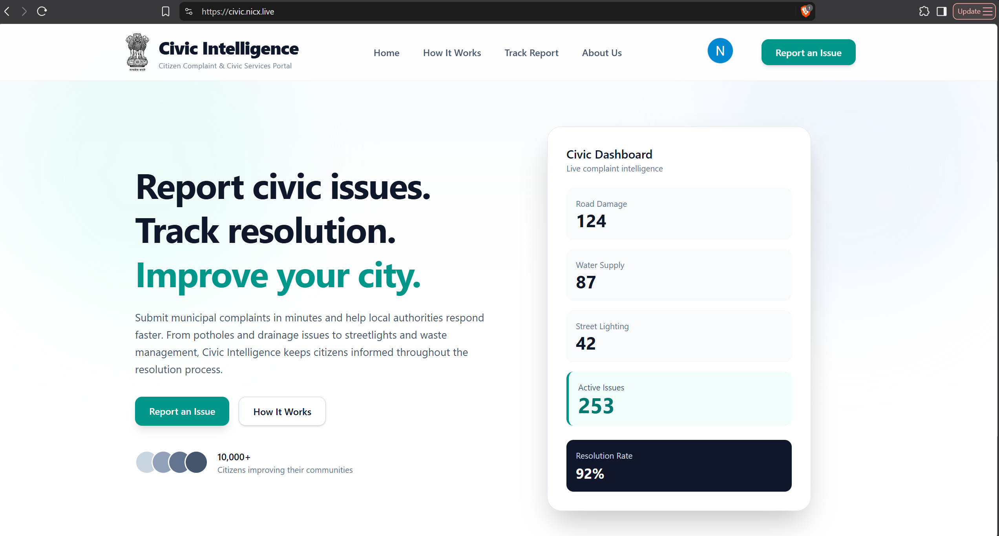
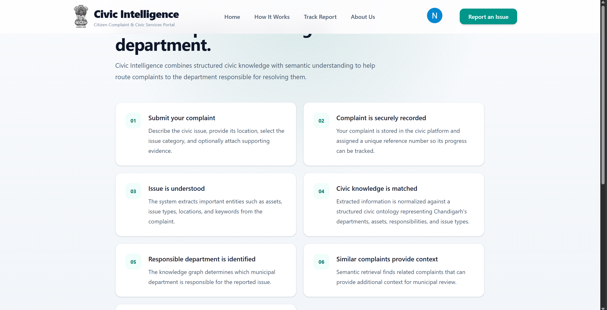
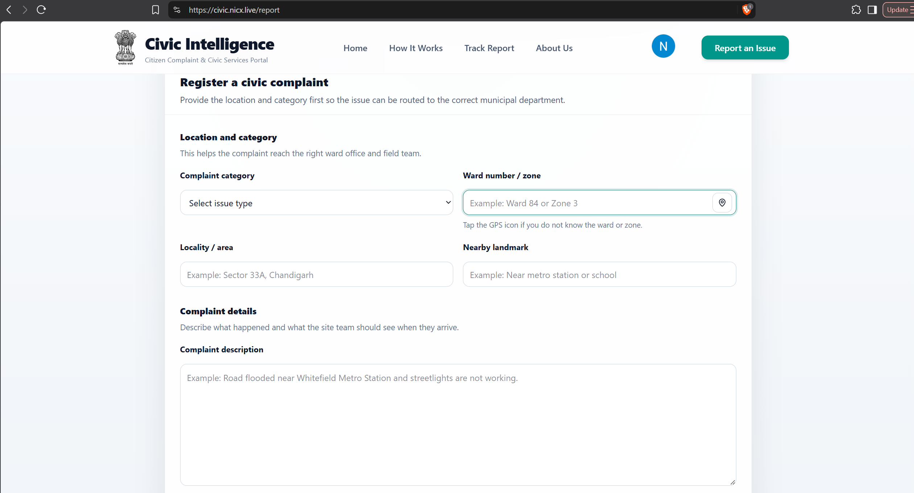
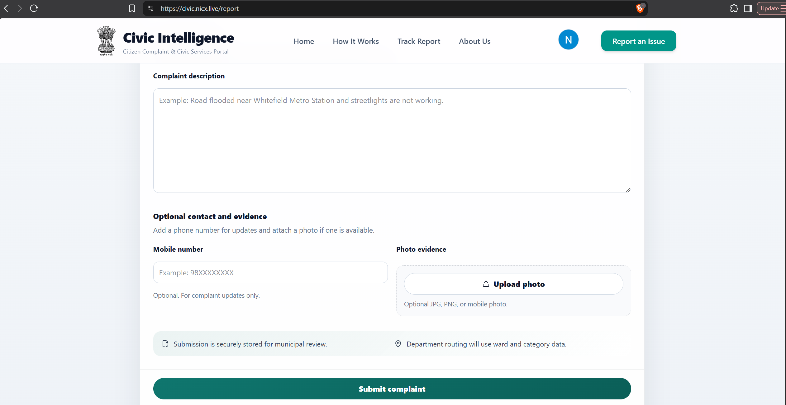
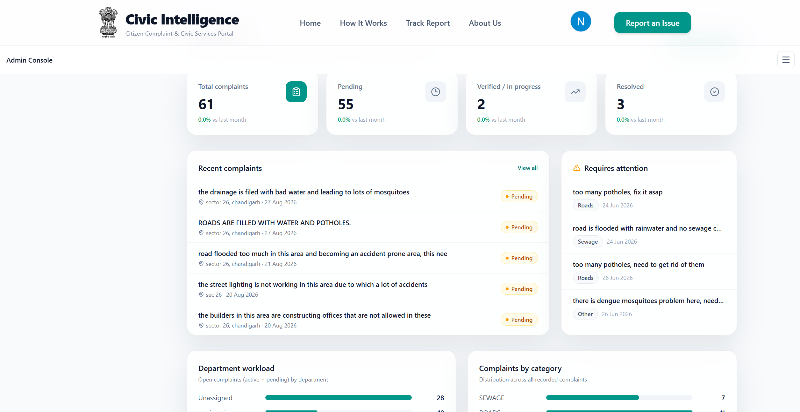
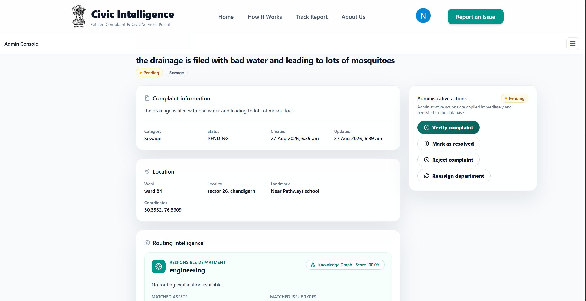

# Civic Intelligence

### AI-Powered Civic Complaint Management and Department Routing

Civic Intelligence is a civic technology platform designed to simplify municipal complaint reporting and improve how civic issues are routed to the responsible departments.

The platform combines a citizen-facing web application with a GraphRAG-based intelligence pipeline that extracts relevant entities, normalizes them against a civic ontology, and uses a knowledge graph to determine departmental responsibility.

**Live Demo:** [civic.nicx.live](https://civic.nicx.live)

---

## Project Overview

Citizens frequently encounter civic issues such as damaged roads, drainage problems, water supply disruptions, waste accumulation, and malfunctioning streetlights. Reporting these issues is only one part of the problem; identifying the appropriate department is equally important.

Civic Intelligence addresses this challenge through a unified complaint management platform with AI-assisted information extraction, ontology normalization, knowledge-graph-based department routing, and semantic retrieval of similar complaints.

The system is designed to make complaints easier to submit while giving administrators greater visibility into complaint details and routing decisions.

---

## Application Screenshots

### 1. Citizen Portal

The citizen-facing interface provides access to the platform's main features, including complaint reporting and information about how the system works.



### 2. How It Works

An overview of the complaint management process and how Civic Intelligence helps connect reported issues with the relevant civic authorities.



### 3. Report a Civic Issue

The complaint submission interface allows citizens to report civic problems through the web application.



The following screenshot shows the additional portion of the reporting interface.



### 4. Administrative Portal

The administrative interface provides a dedicated view for managing and examining civic complaints.



An additional view of the administrative interface is shown below.



---

## Key Features

### Citizen-Facing Application

* Civic complaint reporting interface.
* Dedicated pages explaining the platform and its workflow.
* Complaint tracking functionality exposed through the citizen-facing interface.

### GraphRAG-Based Complaint Intelligence

* Entity extraction from complaint text using a local language model.
* Ontology normalization to align extracted entities with the civic domain.
* Knowledge-graph-based routing to identify responsible departments.
* Semantic retrieval of similar complaints using vector embeddings.

### Administrative Interface

* Centralized complaint management.
* Access to complaint details and routing information.
* Visibility into extracted entities and the reasoning behind departmental responsibility.
* Supporting administrative views for examining civic service activity.

---

## System Architecture

Civic Intelligence combines a web application, a Python-based intelligence pipeline, relational storage, a knowledge graph, and a vector database.

```text
                     CITIZEN
                        |
                        v
              +-------------------+
              |    Next.js Web    |
              |    Application    |
              +-------------------+
                        |
                        v
              +-------------------+
              |   PostgreSQL      |
              | Source of Truth   |
              +-------------------+
                        ^
                        |
              +-------------------+
              |   FastAPI         |
              | GraphRAG Pipeline |
              +-------------------+
                        |
             +----------+----------+
             |                     |
             v                     v
    +----------------+    +----------------+
    | Entity         |    | Ontology       |
    | Extraction     |--->| Normalization  |
    | Qwen3:8B       |    |                |
    +----------------+    +----------------+
                                  |
                                  v
                         +------------------+
                         | Neo4j Knowledge  |
                         | Graph            |
                         +------------------+
                                  |
                                  v
                         Department Routing

             +--------------------------+
             | Qdrant Vector Database   |
             | Semantic Similarity      |
             +--------------------------+

                        |
                        v
              +-------------------+
              | Administrative    |
              | Dashboard         |
              +-------------------+
```

### Architectural Principles

**PostgreSQL as the source of truth**

PostgreSQL stores the application's persistent relational data. The administrative interface reads application records from PostgreSQL rather than treating the graph or vector database as the primary application database.

**Knowledge-graph-based routing**

The knowledge graph represents civic entities and their relationships. Department responsibility is determined through graph-based relationships rather than allowing the language model to select a department without the routing layer.

**Semantic retrieval**

Qdrant supports similarity-based retrieval using vector embeddings, helping the system identify semantically related complaints.

**Separation of responsibilities**

The web application handles the user interface, FastAPI exposes the intelligence pipeline, PostgreSQL manages application data, Neo4j represents civic relationships, and Qdrant supports semantic search.

---

## Technology Stack

| Component        | Technology                              |
| ---------------- | --------------------------------------- |
| Frontend         | Next.js, React, TypeScript              |
| Styling          | Tailwind CSS                            |
| Authentication   | Auth.js / NextAuth.js with Google OAuth |
| ORM              | Prisma                                  |
| Primary Database | PostgreSQL                              |
| Backend API      | Python, FastAPI                         |
| Language Model   | Qwen3:8B via Ollama                     |
| Knowledge Graph  | Neo4j                                   |
| Vector Database  | Qdrant                                  |
| Embeddings       | BGE-M3                                  |
| Containerization | Docker                                  |
| Public Access    | Cloudflare Tunnel                       |
| Source Control   | Git and GitHub                          |

---

## Complaint Intelligence Pipeline

The intelligence pipeline processes complaint information through multiple stages.

1. **Complaint submission:** A citizen submits a description of a civic issue.
2. **Entity extraction:** The language model extracts relevant information from the complaint.
3. **Ontology normalization:** Extracted entities are aligned with the civic ontology.
4. **Knowledge graph processing:** The graph represents relationships between civic issues, entities, and responsible departments.
5. **Department routing:** Graph relationships are used to determine the appropriate departmental responsibility.
6. **Semantic retrieval:** Qdrant supports the retrieval of similar complaints using vector similarity.
7. **Persistence and administration:** Application records are maintained in PostgreSQL and made available to the administrative interface.

This architecture separates language-model-based extraction from responsibility determination, providing a more structured approach to civic complaint routing.

---

## Repository Structure

```text
Civic-Intelligence/
├── src/
│   ├── app/
│   │   └── admin/
│   ├── auth.ts
│   └── ...
├── graphRAG/
│   ├── ...
│   ├── Dockerfile
│   └── requirements.txt
├── prisma/
├── architecture/
├── docs/
├── Datasets/
├── screenshots/
│   ├── admin_page_1.png
│   ├── admin_page_2.png
│   ├── how_it_works_page.png
│   ├── main_landing_page.png
│   ├── report_an_issue_page_1.png
│   └── report_an_issue_page_2.png
├── package.json
├── Dockerfile
└── README.md
```

*Ellipses represent files and directories omitted from this overview.*

---

## Running the Project Locally

### Prerequisites

The development environment requires:

* Node.js and npm.
* Docker Desktop.
* Ollama.
* The configured Qwen3 and BGE-M3 models.
* The environment variables and service configuration required by the application.

### Setup

1. Clone the repository:

   ```bash
   git clone https://github.com/nicx004/Civic-Intelligence.git
   cd Civic-Intelligence
   ```

2. Install the frontend dependencies:

   ```bash
   npm install
   ```

3. Configure the required environment variables using the project's existing configuration and documentation. Do not commit credentials, OAuth secrets, database passwords, or other private values.

4. Ensure the required database services and Ollama models are configured.

5. Start the application using the project's configured Docker setup or development scripts.

The precise startup procedure depends on the available service configuration and environment variables. Consult the repository files before starting or rebuilding containers.

---

## Deployment

The project is accessible through:

**https://civic.nicx.live**

The current deployment uses Cloudflare Tunnel to expose the application running in the local environment.

Consequently, public availability depends on the host machine, application services, and network connection remaining operational.

The deployment should not be interpreted as an independently hosted, always-on cloud deployment.

---

## Engineering Highlights

* Integration of a modern web application with a Python-based AI pipeline.
* Combination of relational storage, knowledge-graph reasoning, and vector similarity search.
* Ontology normalization for structured civic-domain information.
* Separation of entity extraction and departmental responsibility determination.
* Containerized services for local deployment.
* Authentication and administrative interfaces integrated into a unified application.

---

## Future Improvements

Potential areas for further development include:

* More extensive evaluation of departmental routing accuracy.
* Improved observability and error handling across the intelligence pipeline.
* Automated tests for complaint processing and routing.
* Expanded complaint analytics and service-level monitoring.
* Production-oriented cloud deployment with managed infrastructure.
* Stronger evaluation of semantic retrieval quality and duplicate complaint detection.

---

## Project Information

**Repository:** [github.com/nicx004/Civic-Intelligence](https://github.com/nicx004/Civic-Intelligence)

**Live Application:** [civic.nicx.live](https://civic.nicx.live)

Civic Intelligence is an end-to-end civic technology prototype exploring the use of GraphRAG, knowledge graphs, and semantic retrieval to support municipal complaint management.

## Important: Deployment and Local Execution

**The public demo and a local installation have different runtime requirements.**

The live application at [civic.nicx.live](https://civic.nicx.live) is exposed through Cloudflare Tunnel and depends on the host machine and services running in the existing deployment environment. It is not an independently hosted, always-on cloud deployment.

Developers who want to run their own instance should clone the repository and configure the required local services and environment variables.

### Requirements for a Local Instance

* **Frontend:** Next.js application running in the local environment.
* **Backend:** FastAPI-based GraphRAG service.
* **Database:** PostgreSQL for persistent application data.
* **Knowledge graph:** Neo4j for civic relationships and departmental routing.
* **Vector database:** Qdrant for semantic retrieval.
* **AI inference:** Ollama with the required language model and embedding model.

Docker is used to manage the application's containerized services.

### Important Notes

* Accessing the public demo does not install the project or its dependencies on your computer.
* A separate local installation requires the relevant services, credentials, environment variables, and model dependencies to be configured.
* The local backend and supporting services must be running for features that depend on them to work.
* The public demo's availability depends on the existing deployment environment remaining operational.
* Local startup commands should be followed according to the configuration files and instructions in this repository.

For local development, begin with the [repository](https://github.com/nicx004/Civic-Intelligence) and review the setup instructions below.
   